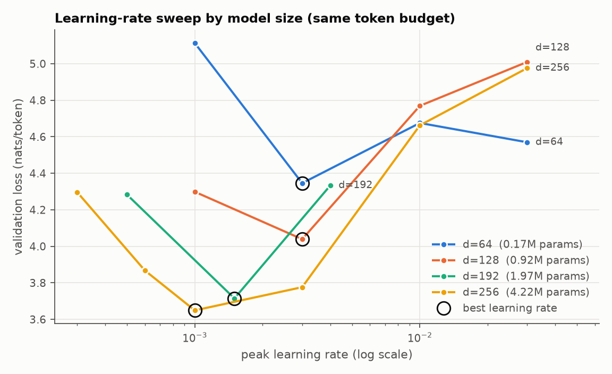
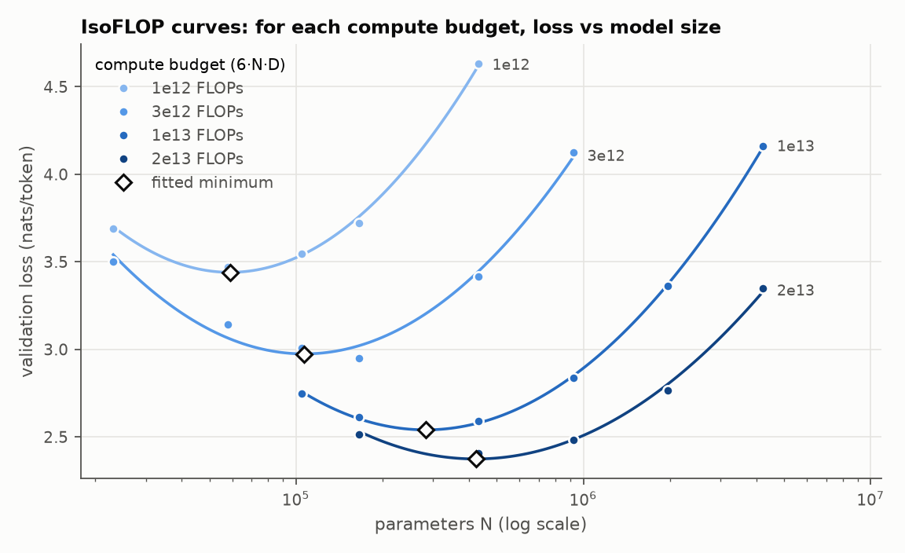
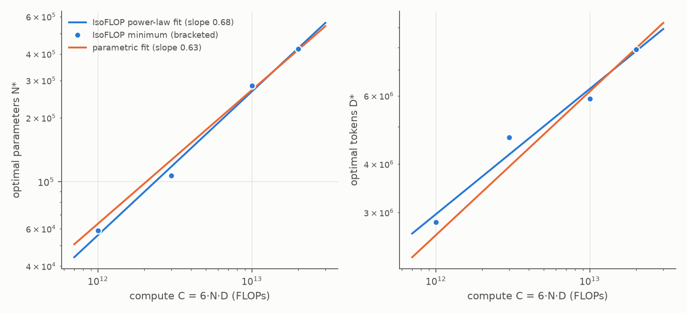
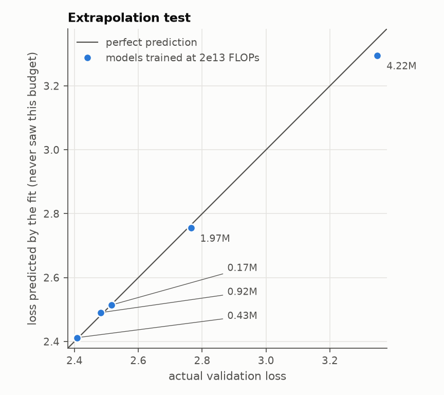

# 10 — Scaling laws: how loss depends on model size, data and compute

## Goal
Every earlier step trained *one* model. Scaling is the study of how performance changes as you change **N** (parameters), **D** (training tokens) and **C** (compute), and the practical question it answers: *given a fixed compute budget, how big should the model be and how long should you train it?* We reproduce the method of the Chinchilla paper at toy scale, on this CPU, and then ask the question that makes scaling laws useful: **does a fit made on small runs predict a larger run it never saw?** Code: `hedy/scaling.py` (runner), `hedy/scalefit.py` (fits), `hedy/scaleplots.py` (figures); tests: `tests/test_scaling.py`.

> **Scope, honestly.** Real scaling studies span 5+ orders of magnitude in compute on GPU clusters. Ours spans about one and a half (10¹²–2·10¹³ FLOPs, models of 58k–4.2M parameters) on 6 CPU cores, one seed per run, one dataset. The *method* transfers; the *numbers* (exponents, constants) do not. Treat them as measurements of this tiny system.

## 1. Theory

### What a scaling law claims
Held everything else fixed (data distribution, architecture family, well-tuned hyper-parameters), test loss falls as a **power law** in each resource, down to a floor:

    L(N, D) = E + A / N^α + B / D^β                      (Hoffmann et al. 2022, "Chinchilla")

- `E` is the **irreducible loss**: the entropy of the text itself (no model of any size beats it).
- `A/N^α` is the **model-size term**: how much worse a finite model is than an infinite one, even with infinite data.
- `B/D^β` is the **data term**: the cost of having seen finite data, even with an infinite model.
- Kaplan et al. (2020) reported pure power laws, `L ∝ N^-0.076`, `D^-0.095`, `C^-0.050` over many orders of magnitude; the key empirical fact is that these straight lines on log-log axes persist across enormous ranges.

### Compute and the allocation problem
A training run costs roughly **C ≈ 6·N·D** FLOPs (2 per parameter per token forward, 4 backward; attention adds a little, which matters more for tiny models; we use the nominal formula). For a fixed `C`, a bigger model sees fewer tokens. Minimizing `L(N, D)` subject to `6ND = C` has a closed form (implemented and tested in `optimal_allocation`):

    N*(C) = G · (C/6)^a,   D*(C) = (C/6)^b / G,    a = β/(α+β),   b = α/(α+β),   a + b = 1

Chinchilla found `a ≈ b ≈ 0.5` (so **N and D should grow together; ≈20 tokens per parameter**), contradicting the earlier Kaplan result (`a ≈ 0.73`: grow the model faster), which had been inflated partly by using a truncated learning-rate schedule and by how parameters were counted (Porian et al., 2024). The practical outcome: many early large models were *under-trained*.

### Three ways to estimate the optimum
1. **Envelope of training curves**: train many sizes, take the lowest loss at each compute value.
2. **IsoFLOP profiles** (our main method): for each compute budget `C`, train several `(N, D=C/6N)` pairs and plot loss vs `N`; the bottom of that U-shaped curve is `N*(C)`. Fit a parabola in `log N` to locate the minimum, then fit a power law `N* ∝ C^a`.
3. **Parametric fit**: fit `E, A, B, α, β` to *all* runs with a robust loss (Huber on log-loss, L-BFGS from many starts), then use the closed form above.

Method 2 is assumption-light but needs the minimum to be *bracketed* by the sizes you trained (we flag the levels where it is not); method 3 uses every run and can extrapolate, but assumes the functional form is right.

### Why this is useful (and where it breaks)
- **Prediction**: a fit on cheap runs tells you what a 10× bigger run should reach, so you can decide whether to launch it, and a run that misses its predicted loss signals a bug.
- **Allocation**: choose model size and token count for a budget.
- **Caveats that matter in practice.**
  - *Hyper-parameters must be tuned per scale.* The best learning rate falls with width (we measure it below; µP, Yang et al. 2022, reparameterizes the model so it transfers). A mistuned big model looks worse than it is and bends the fit.
  - *Each run needs its own full schedule* (warmup + decay to a small value over *that* run's length), not a snapshot of a longer run.
  - *Fresh data.* Repeating data reduces its value; Muennighoff et al. (2023) find up to ~4 epochs are nearly as good as fresh data, beyond which returns collapse. That is why this step trains on a 67M-token subset and keeps every run under one epoch.
  - *Loss is not capability.* Laws are smooth in loss; downstream benchmarks can look like sudden "emergence", though much of that is an artifact of the metric (Schaeffer et al., 2023).
  - *Compute-optimal ≠ deployment-optimal.* Inference cost is paid per use, so models destined for heavy serving are deliberately **over-trained** past the Chinchilla ratio (e.g. LLaMA-style 100×+ tokens per parameter; Sardana & Frankle 2023).
  - *Batch size* should grow with compute (critical batch size, McCandlish et al. 2018); we hold 4,096 tokens per step fixed for all runs, which is fine at this scale but a simplification.

## 2. Setup

**Model family** (`hedy/scaling.py`): the step-03 architecture (RoPE, RMSNorm, SwiGLU), context 128, no dropout, vocabulary 1,024, head dimension 32 for d ≥ 64 (for d = 16, 32, 48 there is a single head, so the head dimension equals d), widths 16–256 with 2–5 layers, giving **23k to 4.2M parameters** (N counts every parameter; the tied embedding is counted once, so for the smallest models it is the *majority* of N: 56% at d=32, 6% at d=256).

| d | 16 | 32 | 48 | 64 | 96 | 128 | 192 | 256 |
|---|---|---|---|---|---|---|---|---|
| layers | 2 | 2 | 2 | 2 | 3 | 4 | 4 | 5 |
| N | 23,120 | 58,016 | 104,688 | 166,208 | 430,752 | 922,752 | 1,967,808 | 4,217,600 |

**Data**: a 67.4M-token slice of TinyStories (the first 200 MB of its training file; 229k stories), tokenized with the *same* BPE as steps 05–09 (`hedy.prepare --tokenizer … --train_only`, now streaming in chunks so the corpus never sits in RAM). **No run exceeds 20M tokens, so every run sees fresh data** (no epochs). Validation is the same 1,099 held-out stories as before. Leakage check (the habit from step 06): 0 of the 1,099 validation stories appear verbatim in this training slice; 31 share a 120-character opening, 1 shares 250, 0 share 400, and the dataset itself is formulaic (8% of training stories share a 120-character opening with another training story). No meaningful overlap.

**Protocol**: every run is a complete schedule of its own (linear warmup, cosine decay to 10%), batch 32×128 = **4,096 tokens/step** for all runs, AdamW (β2=0.95, weight decay 0.1 on matrices), seed 0 unless stated. Validation loss is measured on **2,400 fixed, evenly spaced windows** (identical for every run, so no evaluation-sampling noise between runs; `fixed_val_loss`). Nominal compute `C = 6·N·D`. **Grid**: compute levels 1e12, 3e12, 1e13, 2e13 FLOPs; at each, 5–6 model sizes with `D = C/(6N)` (capped at 20M tokens), 22 runs total, plus 4 replicate runs with other seeds to measure noise.

The runs and the learning-rate sweep are committed as data: `docs/data/scaling_runs.jsonl`, `docs/data/scaling_lr.jsonl`. Re-create the analysis with `python -m hedy.scaling fit --runs docs/data/scaling_runs.jsonl --lr_runs docs/data/scaling_lr.jsonl --figs docs/figures`.

## 3. Results

### 3.1 First, tune the learning rate per size (and see why you must)
Same token budget (0.6M tokens, 146 steps) at every size; validation loss (nats/token), best in bold.

| d (N) | 3e-4 | 5e-4 | 6e-4 | 1e-3 | 1.5e-3 | 3e-3 | 4e-3 | 1e-2 | 3e-2 |
|---|---|---|---|---|---|---|---|---|---|
| 64 (0.17M) | | | | 5.113 | | **4.346** | | 4.675 | 4.570 |
| 128 (0.92M) | | | | 4.299 | | **4.039** | | 4.769 | 5.010 |
| 192 (1.97M) | | 4.283 | | | **3.715** | | 4.333 | | |
| 256 (4.22M) | 4.297 | | 3.868 | **3.649** | | 3.776 | | 4.662 | 4.976 |

The best learning rate **falls as the model gets wider**: a parabola through the three points nearest each minimum gives about 4.0e-3 (d=64), 2.4e-3 (128), 1.4e-3 (192) and 1.5e-3 (256), roughly `lr ∝ d^-0.75` over the range where I measured it. Using 3e-3 for everything would have cost the d=256 model 0.13 nats (3.776 vs 3.649) at this budget, and 1e-2 would have wrecked it. This is why scaling studies tune per size, and why µP (which makes the optimum width-independent) is attractive. I used 4e-3 for d ≤ 64, 3e-3 (96), 2.4e-3 (128), 1.5e-3 (192) and 1.4e-3 (256). **Limits**: d=16/32/48/96 were not swept directly (interpolated), and the sweep used short runs, whose best LR is higher than for long ones, so the long, small-N runs in the grid are probably slightly over-tuned *upward*. I did not test how much that matters.

### 3.2 How noisy is a single run?
Same configuration, three seeds (the seed changes the weight initialization and the order of training batches):

| config | losses (seed 0 / 1 / 2) | std |
|---|---|---|
| d=64, 3.0M tokens | 2.947 / 2.983 / 2.969 | **0.018** |
| d=128, 0.54M tokens | 4.127 / 4.052 / 4.058 | **0.042** |

So a single run carries **±0.02–0.04 nats of seed noise** (0.7–1.4% of the loss), larger for very short runs. Every statement below about differences smaller than ~0.04 nats is below the noise floor. (The fixed validation windows remove *evaluation* noise; this is *training* noise.)

### 3.3 The grid
Each row is one run (seed 0). Tokens/parameter = D/N. The best loss at each compute level is in bold.

| C | d | N | D (tokens) | tokens / param | val loss |
|---|---|---|---|---|---|
| 1e12 | 16 | 23,120 | 7.21M | 312 | 3.689 |
| 1e12 | **32** | 58,016 | 2.87M | 49 | **3.470** |
| 1e12 | 48 | 104,688 | 1.59M | 15 | 3.547 |
| 1e12 | 64 | 166,208 | 1.00M | 6.0 | 3.722 |
| 1e12 | 96 | 430,752 | 0.39M | 0.9 | 4.632 |
| 3e12 | 16 | 23,120 | 21.6M | 935 | 3.502 |
| 3e12 | 32 | 58,016 | 8.62M | 149 | 3.145 |
| 3e12 | 48 | 104,688 | 4.78M | 46 | 3.007 |
| 3e12 | **64** | 166,208 | 3.01M | 18 | **2.947** |
| 3e12 | 96 | 430,752 | 1.16M | 2.7 | 3.417 |
| 3e12 | 128 | 922,752 | 0.54M | 0.6 | 4.127 |
| 1e13 | 48 | 104,688 | 15.9M | 152 | 2.747 |
| 1e13 | 64 | 166,208 | 10.0M | 60 | 2.615 |
| 1e13 | **96** | 430,752 | 3.87M | 9.0 | **2.591** |
| 1e13 | 128 | 922,752 | 1.81M | 2.0 | 2.839 |
| 1e13 | 192 | 1,967,808 | 0.85M | 0.4 | 3.362 |
| 1e13 | 256 | 4,217,600 | 0.39M | 0.1 | 4.162 |
| 2e13 | 64 | 166,208 | 20.0M | 121 | 2.516 |
| 2e13 | **96** | 430,752 | 7.74M | 18 | **2.409** |
| 2e13 | 128 | 922,752 | 3.61M | 3.9 | 2.482 |
| 2e13 | 192 | 1,967,808 | 1.70M | 0.9 | 2.765 |
| 2e13 | 256 | 4,217,600 | 0.79M | 0.2 | 3.349 |

For the same compute, the model you pick matters enormously: at 2e13 FLOPs the 4.2M-parameter model (the biggest one you could afford to *instantiate*) is **0.94 nats worse** than the best choice (0.43M), and the 2M model 0.36 worse. Equivalently, the best allocation reaches the loss that big model gets at 2e13 with about **16× less compute** (≈1.2e12 FLOPs, interpolating the optimum curve). *A bigger model on too little data is worse than a smaller one on enough data.*

### 3.4 IsoFLOP curves

Each compute budget gives a clean U: too-small models are capacity-limited, too-large ones are data-starved, and the minimum moves right as the budget grows. All four minima are *bracketed* (the best observed run is interior, not an endpoint). An early version of my "bracketed" test only checked that the parabola's vertex fell inside the range, which wrongly passed the 1e12 curve before I added the 23k-parameter model; three points always fit a parabola, so the vertex can land inside a range whose true optimum is outside it. The fix (best observed run must be interior) is now tested.

| C | N* (parabola) | D* | tokens / param | L* | runs |
|---|---|---|---|---|---|
| 1e12 | 58.9k | 2.83M | 48.0 | 3.440 | 5 |
| 3e12 | 106.8k | 4.68M | 43.8 | 2.974 | 6 |
| 1e13 | 282.9k | 5.89M | 20.8 | 2.540 | 6 |
| 2e13 | 422.0k | 7.90M | 18.7 | 2.374 | 5 |

### 3.5 The fitted laws

**IsoFLOP power law** (4 bracketed levels): `N* ∝ C^0.68` (standard error 0.04), `D* ∝ C^0.32`. Dropping one level at a time moves the exponent between 0.66 and 0.73.

**Parametric fit** (all 22 runs, Huber on log-loss, L-BFGS from 16 starts):

    L(N, D) = 1.36 + 80.5 / N^0.371 + 8772 / D^0.631

| parameter | estimate | 95% bootstrap interval (100 resamples of the runs) |
|---|---|---|
| α (model-size exponent) | 0.371 | 0.30–0.43 |
| β (data exponent) | 0.631 | 0.56–0.73 |
| N\* exponent β/(α+β) | 0.63 | 0.61–0.69 |
| E (irreducible loss) | 1.36 nats (≈0.64 bits/byte) | 0.93–1.47: **poorly identified** |

The two methods agree that the optimal model size grows **faster than √C** (0.63–0.68, versus Chinchilla's ≈0.5), and they predict the same optimum at each budget to within ~10%:

| C | IsoFLOP N* | parametric N* | parametric D* | tokens/param | predicted L* |
|---|---|---|---|---|---|
| 1e12 | 58.9k | 63.5k | 2.62M | 41 | 3.471 |
| 3e12 | 106.8k | 126.8k | 3.94M | 31 | 2.994 |
| 1e13 | 282.9k | 270.7k | 6.16M | 23 | 2.594 |
| 2e13 | 422.0k | 418.8k | 7.96M | 19 | 2.410 |

Where the fit is worst: residual rms 0.047 nats, max 0.157. The worst misfits are the severely under-trained runs (d=128 at 0.6 tokens/param, +0.157; d=96 at 2.7, +0.095): a handful of ~130-step runs where a smooth power law in D is a poor description (and where seed noise is largest, ±0.04).

**The exponent is not a constant of nature; it depends on bookkeeping.** Counting only the non-embedding ("body") parameters, as Kaplan et al. did, the same data give α=0.23, β=0.63 and an optimal-size exponent of **0.73**, which happens to be Kaplan's number, versus 0.63 with all parameters counted. In this toy the embedding share of N varies from 56% to 6% across the family, so the convention changes the answer by 0.10. It is a clean, small demonstration of one reason published exponents disagree (the others include learning-rate schedules and tuning). I have not isolated how much each factor contributes, so treat the 0.63–0.73 range as "what you get from this experiment under different, reasonable conventions", not as a result that "contradicts Chinchilla".

**Tokens per parameter**: 48 → 44 → 21 → 19 at the four budgets, so near the Chinchilla ratio (~20) at the two largest budgets, but trending *down*, as expected from an exponent above 0.5 (with `a > b`, D/N shrinks as C grows). One fixed "20 tokens per parameter" rule would be wrong at the small budgets here.

### 3.6 Does the fit predict runs it never saw?
This is the reason to fit a law at all.

| test | what was held out | mean \|error\| | per-run errors |
|---|---|---|---|
| larger budget | all five runs at 2e13 (fit on 1e12–1e13) | **0.50%** | +0.14, +0.33, −0.34, −1.61, −0.07 % |
| larger models | the 2M and 4.2M runs (fit never saw N > 0.92M) | **1.3%** | −1.4, +1.6, −0.6, −1.7 % |
| largest model only | the 4.2M runs (fit saw N ≤ 2.0M) | **2.5%** | +4.8, −0.1 % |
| leave-one-out | each of the 22 runs in turn | 1.29% (median 0.61%, max 4.9%) | |

The fit also picked the correct best model size at 2e13 (0.43M). For scale, the **seed-to-seed noise is 0.7–1.4%**, so most of these errors are *at the noise floor*. This is encouraging but **a weaker test than it sounds**: the budget jump is only 2×, the "larger models" are only 2.1–4.6× beyond the largest model the fit saw, and the real-world use of scaling laws (predicting a 10–1000× larger run) is an extrapolation I could not test on this hardware. What the data supports: *on this task, a five-parameter law fitted on a small grid predicts nearby unseen configurations to about the noise level, and tells you which size to pick.*

### 3.7 Wall-clock is not FLOPs
Measured single-process throughput (4 threads) and the nominal FLOP rate it implies:

| d | N | tokens/s | nominal GFLOP/s |
|---|---|---|---|
| 16 | 23k | 59,500 | 8 |
| 32 | 58k | 54,000 | 19 |
| 64 | 166k | 37,900 | 38 |
| 128 | 923k | 14,100 | 78 |
| 192 | 1.97M | 7,900 | 94 |
| 256 | 4.22M | 4,200 | 107 |

Small models run at roughly a tenth of the hardware rate of the larger ones (kernel-launch and Python overhead dominate), so **equal-FLOP runs have very unequal wall-clock cost**: at 3e12 FLOPs the d=16 run took 365 s and the d=128 run 38 s. (The 6·N·D formula also ignores attention FLOPs, which are a bigger share for tiny models.) A budget measured in *seconds* would shift the optimum toward larger models than a budget measured in FLOPs. Separately, this machine has 6 physical cores: several concurrent runs split a fixed throughput (1 process at 4 threads ≈ 3 processes together), so running the grid in parallel bought nothing.

### 3.8 What the fit says beyond the data (with a strong warning)
Extrapolating the fitted law beyond the range I measured (1e14 FLOPs is only 5× my largest budget, but the point below is ~300×): the optimum would be ~1.2M parameters / 14M tokens at 1e14 FLOPs, and the compute-optimal token count would reach one pass over this 67M-token corpus at roughly **C ≈ 6e15** FLOPs, beyond which more compute is only useful with more *data*, the "data wall" that motivates data-constrained scaling work. Please read these as an illustration of how the law is *used*, not as predictions I trust: the range is vast, E is poorly identified, and one more decade of compute could bend the curve.

## 4. Lessons
- **Tune the learning rate per size** before comparing sizes; its optimum moves (here ∝ ~d^-0.75) and a shared value penalizes the large models.
- **Measure your noise floor first.** ±0.02–0.04 nats of seed noise set what any later difference can mean. Report replicates.
- **Use IsoFLOP curves and check that each minimum is bracketed.** A parabola fitted to three points always has a vertex; the real question is whether the *data* turn around.
- **The optimum depends on bookkeeping** (embedding parameters, FLOP accounting, schedules, batch size). Quote exponents with the convention attached.
- **A fitted law is only as good as its test on unseen configurations.** Hold out the large end, not random points.
- **Compute-optimal is not cost-optimal**: inference cost, hardware efficiency, and data supply all move the real optimum.

## 5. What this step doesn't do
- Orders of magnitude more compute, or models large enough to see the regimes where laws bend.
- Multiple seeds for the whole grid (only 2 configurations were replicated), or per-run learning-rate tuning at each budget (µP would remove the need).
- Batch-size scaling, data-mix/quality scaling, or **downstream-task scaling**: only validation loss was studied.
- Repeated-data scaling (every run here is < 1 epoch), and parameter counts that separate embedding from body (only used as a sensitivity check).

## 6. Exercises
1. Re-fit with non-embedding parameters from the start and with attention FLOPs included in `C` (`6N + 12·L·d·T` per token); regenerate the IsoFLOP levels. How far does the exponent move toward 0.5?
2. Replace the cosine-to-10% schedule with a **constant** learning rate + short decay (WSD / "trapezoid" schedule), which lets one run provide losses at many token counts. Rebuild the grid from fewer runs.
3. Run the grid with **two more seeds** at each point and fit with the replicate means. Does the exponent's bootstrap interval narrow? Which levels' minima are noisiest?
4. Measure the learning-rate optimum on a *long* run at one size, and compare with the short-run optimum. By how much does it shift, and how would that change the small-N points in the grid?
5. Hold out the **two largest compute levels** and see how the fit's prediction degrades as the extrapolation distance grows.
6. Train a model at the predicted optimum for 1e14 FLOPs (about 1.2M parameters on 14M tokens, ≈1 hour here) and compare its loss with the law's prediction of 2.08 (a real 5× extrapolation test).
7. Add a **data-quality** axis: repeat the study on TinyStories filtered to long stories. Does `E`, `B` or `β` change?
8. Evaluate downstream behaviour: run the step-06 multiple-choice benchmark at each model size on the compute-optimal runs. Is accuracy smooth in loss, or step-like?
9. Estimate the **overtraining** trade-off: for a fixed *inference* budget, compare the compute-optimal model with a 2× smaller one trained 4× longer to reach the same loss.
10. Implement µP-style init/LR scaling and check that one learning rate transfers across d=64…256.

## 7. Further reading
- Kaplan et al., *Scaling Laws for Neural Language Models* (2020)
- Hoffmann et al., *Training Compute-Optimal Large Language Models* (Chinchilla, 2022)
- Porian et al., *Resolving Discrepancies in Compute-Optimal Scaling of Language Models* (2024): why Kaplan and Chinchilla disagree
- Muennighoff et al., *Scaling Data-Constrained Language Models* (2023)
- Sardana & Frankle, *Beyond Chinchilla-Optimal: Accounting for Inference in Language Model Scaling Laws* (2023)
- Yang et al., *Tensor Programs V: Tuning Large Neural Networks via Zero-Shot Hyperparameter Transfer* (µP, 2022)
- McCandlish et al., *An Empirical Model of Large-Batch Training* (2018)
- Hägele et al., *Scaling Laws and Compute-Optimal Training Beyond Fixed Training Durations* (2024): WSD schedules
- Schaeffer et al., *Are Emergent Abilities of Large Language Models a Mirage?* (2023); Wei et al., *Emergent Abilities of Large Language Models* (2022)
- Epoch AI, *Chinchilla scaling: a replication attempt* (2024): a cautionary example of fitting these laws

**Next:** 11, putting it all together: a final model with the best recipe from steps 01–10, and an honest write-up of what worked.
